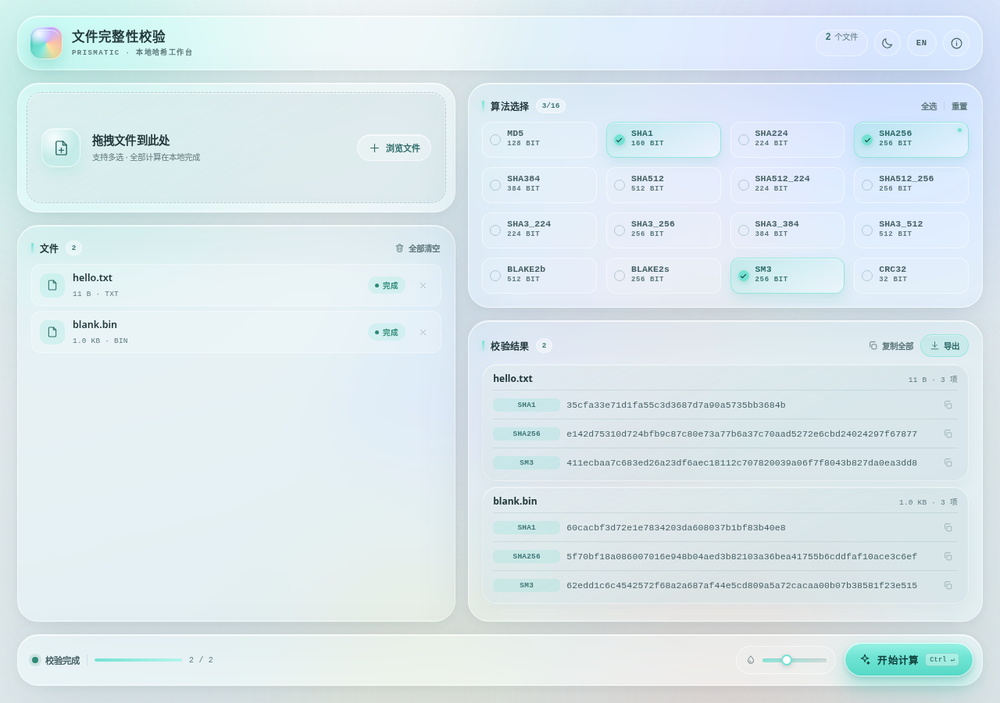

# 文件完整性校验 / FileChecker

使用 Go 重构的本地文件完整性校验工具，面向 Windows。界面采用 **Prismatic Tactility** 设计语言：柔和的棱镜光晕、雾面玻璃面板、薄荷色强调与细腻的立体触感。

所有计算都在本机完成，文件不会被上传到任何服务器。



## 功能

- **16 种哈希算法**：MD5、SHA-1、SHA-2 全系列（含 SHA-512/224、SHA-512/256）、SHA-3 全系列、BLAKE2b、BLAKE2s、国密 SM3、CRC32。
- **一次读取，多算法并行计算**：文件只读取一遍，同时更新所有已选算法，大文件不会整体载入内存。
- **拖拽 / 多选添加文件**：支持拖放或文件选择器，重复文件自动跳过。
- **实时状态与进度**：逐文件显示就绪、计算中、完成、失败状态，并提供整体进度条。
- **结果操作**：复制单个哈希、复制全部、导出 `.txt`（格式与旧版保持一致：`文件名-- 算法:值 …`）。
- **中英双语**：界面内即时切换，无需重启。
- **浅色 / 深色主题**：深色模式沿用同一套棱镜玻璃设计令牌。
- **玻璃质感调节**：滑块实时改变玻璃面板的透明度。
- **纯 Go、无 CGO、无外部运行时**：单个 `FileChecker.exe`，无需安装 Go、Python 或 Node。

## 运行

直接双击 `dist/FileChecker.exe`。

应用会：

1. 在 `127.0.0.1` 的随机端口启动一个轻量本地服务；
2. 生成一次性访问令牌，并用系统 Edge / Chrome 的 `--app` 模式打开无地址栏窗口；
3. 在窗口关闭后自动退出（约 8 秒宽限期，便于刷新页面）。

> Windows 10/11 自带 Edge，可直接使用。若系统没有 Edge/Chrome，会退回默认浏览器以标签页方式打开，功能不受影响。程序为未签名构建，Windows SmartScreen 可能提示，选择“仍要运行”即可。

### 命令行参数

```text
-port int     监听端口，0 表示随机端口（默认 0）
-no-open      不自动打开浏览器窗口
-version      输出版本号后退出
```

本地开发时：

```bash
go run . --no-open --port 8137
```

终端会打印带访问令牌的完整 URL，在浏览器中打开即可。

## 从源码构建

需要 Go **1.24+**。

Windows 下双击或执行：

```bat
build.bat
```

在 Linux / macOS 上交叉编译 Windows 版本：

```bash
./build.sh
```

产物为 `dist/FileChecker.exe`。

## 测试

```bash
go test ./...
```

覆盖内容：

- 16 种算法对空输入、`abc`、1 MiB 多块输入与 OpenSSL/Python 参考值的逐项比对；
- 分块流式写入与一次性写入结果一致；
- 纯 Go SM3 实现的 `Sum` 状态不变性与标准测试向量；
- 本地 HTTP 服务的令牌会话、静态资源、哈希 API 与错误处理。

界面通过 Playwright 做了端到端验证：拖拽添加、哈希结果与参考值比对、复制/导出、重复文件跳过、主题与语言切换、响应式布局及控制台错误检查。

## 项目结构

```text
.
├── main.go                    # 启动本地服务、打开应用窗口、生命周期管理
├── internal/
│   ├── hashkit/               # 流式哈希引擎、SM3 纯 Go 实现、算法注册表
│   ├── host/                  # Windows 浏览器窗口启动 / 原生错误提示
│   └── webapp/                # 回环 HTTP 服务、令牌会话、内嵌前端
│       └── web/               # HTML / CSS / JavaScript（Prismatic Tactility）
├── build.bat / build.sh       # Windows 构建脚本
├── dist/FileChecker.exe       # 构建产物
├── docs/screenshot.png        # 界面截图
└── README.md
```

## 实现说明

- **界面**：原生 HTML/CSS/JS，通过 `go:embed` 打包进二进制；不使用前端框架、不依赖 CDN 或在线字体。
- **安全**：服务仅绑定 `127.0.0.1`；API 需要本次运行生成的随机令牌（首次通过 URL 参数换取 `HttpOnly`、`SameSite=Strict` Cookie），页面启用严格 CSP；关闭窗口后服务自动停止。
- **哈希**：SHA-2、SHA-3 使用 Go 标准库，BLAKE2 使用 `golang.org/x/crypto`，SM3 按 GB/T 32905-2016 以纯 Go 流式实现，CRC32 使用 IEEE 多项式。
- **导出**：优先使用浏览器保存对话框（File System Access API），不可用时回退为下载 `hash-results.txt`。
- **旧版迁移**：原 Python/Tkinter 实现已被本 Go 版本完整替代，文本导出格式保持兼容。

## 许可证

[Unlicense](LICENSE)（延续原仓库）。
